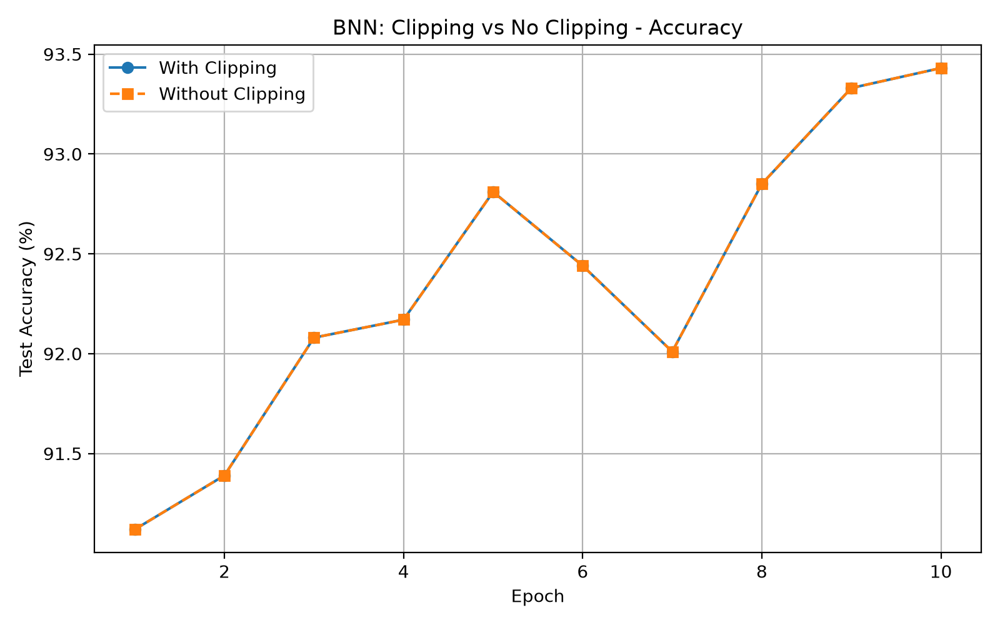
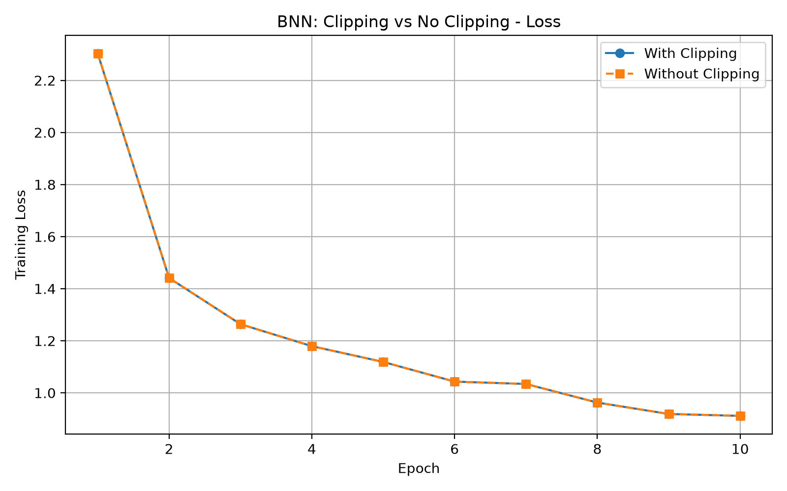
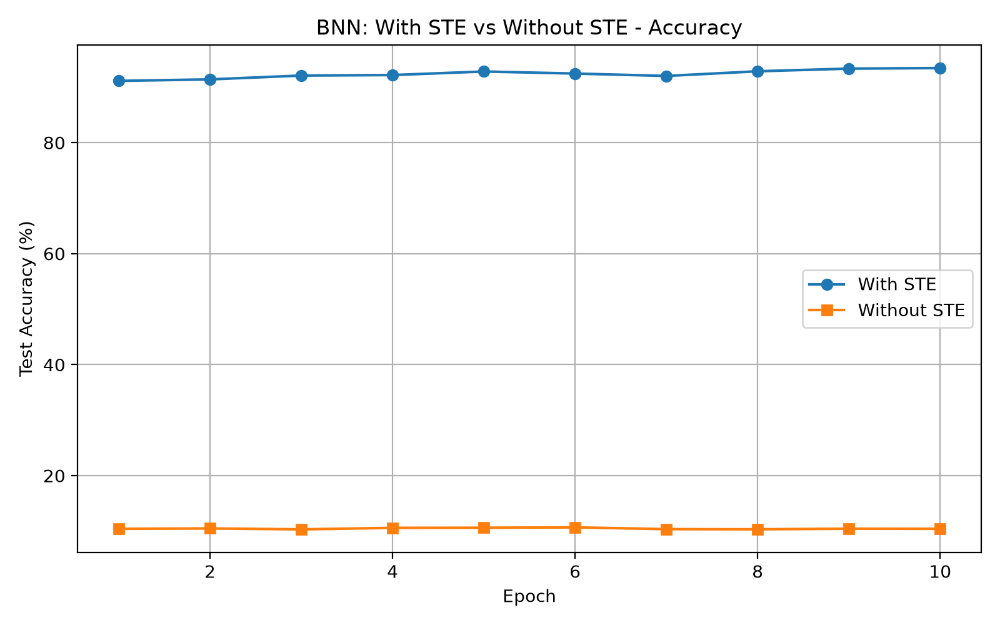
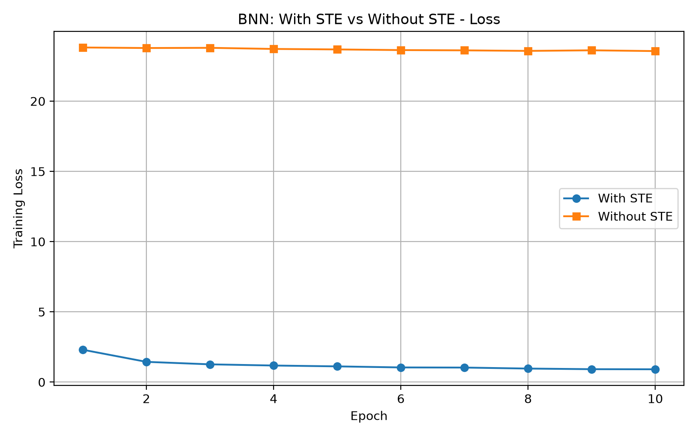
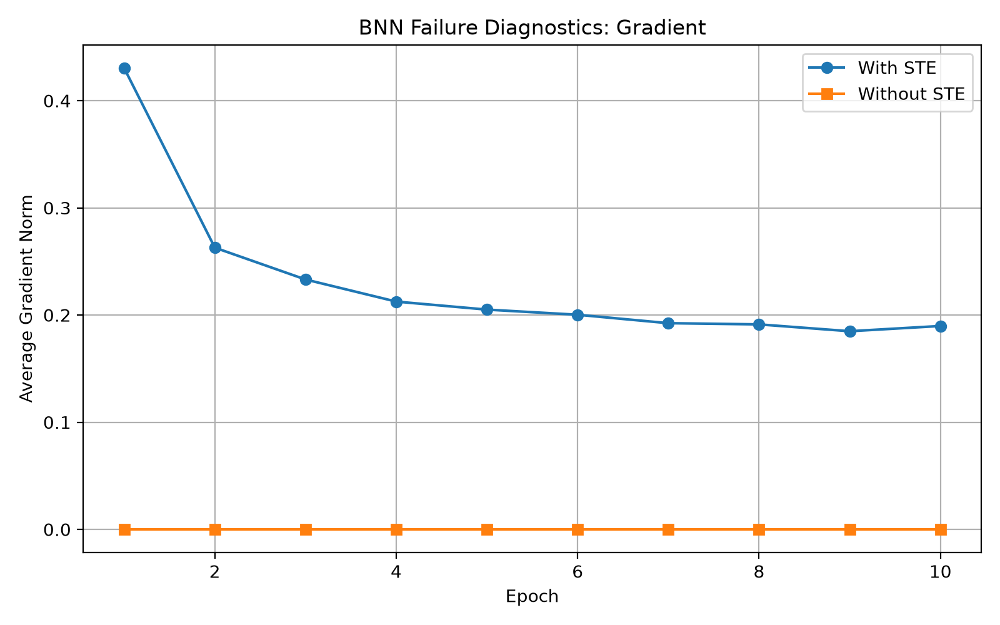
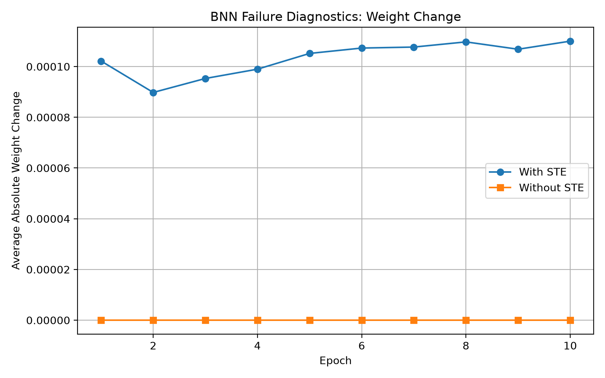

# BNN on MNIST — Ablation Experiments and Failure Diagnostics

## 1. Overview

This report presents three experiments investigating the behavior of a Binarized Neural Network (BNN) trained on the MNIST handwritten digit dataset.

The experiments focus on:

1. Weight clipping versus no weight clipping.
2. Training with and without the Straight-Through Estimator (STE).
3. Failure diagnostics using gradients and weight updates.

The goal is to understand which components are important for training a BNN and what happens when they are removed.

## 2. Experimental Setup

The experiments use the BNN implementation provided in our project.

| Setting | Value |
|---|---|
| Dataset | MNIST |
| Model | Binarized Neural Network |
| Input features | 784 |
| Hidden units | 256 |
| Output classes | 10 |
| Optimizer | Adam |
| Learning rate | 0.001 |
| Batch size | 100 |
| Training epochs | 10 |
| Random seed | 577 |
| Weight binarization | Sign function |
| Gradient approximation | Straight-Through Estimator |

The experiments compare different training configurations while keeping the main model architecture and training settings consistent.

## 3. Experiment 1: Weight Clipping Ablation

### Objective

To investigate whether clipping the real-valued weights to the range [-1, 1] affects BNN training performance.

### Results

| Metric | With Clipping | Without Clipping |
|---|---:|---:|
| Final test accuracy | 93.43% | 93.43% |
| Final training loss | 0.9116 | 0.9116 |
| Maximum absolute weight | 0.5861 | 0.5861 |

During the experiment, zero weights required clipping.

### Accuracy Comparison

### Training Loss Comparison

### Discussion

Both configurations produced identical accuracy and loss curves.

The maximum observed absolute weight was 0.5861, which remained within the clipping interval [-1, 1].

Therefore, the clipping operation did not change any weights during this experiment.

This explains why removing clipping had no measurable effect on training performance.

### Conclusion

Weight clipping did not affect this particular training run because the weights never exceeded the clipping boundaries. This does not mean clipping is unnecessary in every BNN configuration.

## 4. Experiment 2: Straight-Through Estimator Ablation

### Objective

To evaluate whether the Straight-Through Estimator is necessary for training binarized weights.

The STE approximates gradients through the non-differentiable sign function during backpropagation.

In the no-STE control, the backward function returns zero gradients through the binarization operation.

### Results

| Metric | With STE | Without STE |
|---|---:|---:|
| Final test accuracy | 93.43% | 10.42% |
| Final training loss | 0.9116 | 23.5647 |

### Accuracy Comparison

### Training Loss Comparison

### Discussion

With STE enabled, the BNN reached 93.43% test accuracy after 10 epochs.

Without STE, accuracy remained near 10%, approximately the chance-level accuracy for a balanced 10-class classification task.

The training loss also remained high without STE.

These results demonstrate that the gradient approximation is important for learning the binarized weights.

### Conclusion

Removing STE prevented effective training of the binarized weights in our implementation.

## 5. Experiment 3: Failure Diagnostics

### Objective

To investigate why training fails without STE by measuring gradients and changes in the first binarized layer's weights.

### Results

| Metric at Epoch 10 | With STE | Without STE |
|---|---:|---:|
| Training loss | 0.9346 | 23.5885 |
| Gradient norm | 0.189770 | 0.000000 |
| Average absolute weight change | 0.00011001 | 0.00000000 |

### Gradient Comparison

### Weight Update Comparison

### Discussion

With STE enabled, the first binarized layer received nonzero gradients, allowing its real-valued weights to update during training.

Without STE, the measured gradients were zero and the first binarized layer's weights did not change.

This provides a direct explanation for the poor performance observed in Experiment 2.

The diagnostics focus on the first binarized layer. Other parameters, such as biases and BatchNorm parameters, may behave differently.

### Conclusion

STE enables gradient-based learning through the binarization operation. Without this approximation, the first binarized layer cannot update its weights using backpropagation.

## 6. Overall Findings

The experiments produced three main findings:

1. **Weight clipping:** No performance difference was observed because the weights remained within the clipping interval.
2. **STE:** Disabling STE reduced test accuracy from 93.43% to 10.42%.
3. **Failure diagnostics:** Zero gradients and zero weight updates in the first binarized layer explain the training failure without STE.

Together, these results show that STE was essential for effective learning in our BNN implementation, while weight clipping was inactive under the tested settings.

## 7. Experiment Files

| File | Purpose |
|---|---|
| `experiments/clipping_ablation.py` | Weight clipping comparison |
| `experiments/no_ste_control.py` | STE ablation |
| `experiments/failure_diagnostics.py` | Gradient and weight update diagnostics |
| `experiments/clipping_results.csv` | Clipping experiment results |
| `experiments/no_ste_results.csv` | STE experiment results |
| `experiments/failure_diagnostics.csv` | Failure diagnostic results |

All six experiment graphs are saved in the `experiments/` directory.

## 8. Reference

Courbariaux, M., Hubara, I., Soudry, D., El-Yaniv, R., & Bengio, Y. (2016). *Binarized Neural Networks: Training Neural Networks with Weights and Activations Constrained to +1 or −1*. arXiv:1602.02830.
